<h1 align="center">
  <br>
  Readly
</h1>

<p align="center">
  <strong>Reading Vietnamese literature, the fun way.</strong><br>
  An AI-guided reading app for grade-12 literature. Students read short segments, answer questions before, during and after reading, get rubric-based feedback from AI, earn points, keep a reading streak and collect badges. Teachers assign works and follow their class; admins build the content with AI help.
</p>

<p align="center">
  <a href="https://readly-production-3cec7280.up.railway.app"></a>
  <a href="https://github.com/xuan-tu-ai/Readly/actions/workflows/ci.yml"></a>
  
  
  
  
  
</p>

<p align="center">
  <strong>English</strong> · <a href="README.vi.md">Tiếng Việt</a>
</p>

<p align="center">
  <a href="#try-it">Try it</a> · <a href="#highlights">Highlights</a> · <a href="docs/architecture.md">Architecture</a> · <a href="docs/development.md">Development</a> · <a href="docs/deploy.md">Deploy</a> · <a href="docs/configuration.md">Configuration</a>
</p>

<p align="center">
  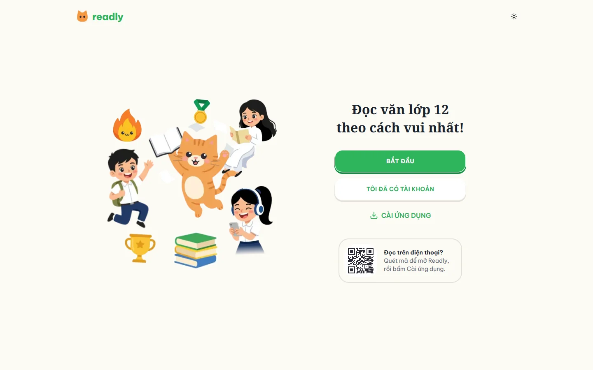
</p>

> [!NOTE]
> Readly is a **student engineering project**. It has no real students or teachers; all user data is sample data. The app is built for Vietnamese high-school students, so its interface and content are in Vietnamese.

## Try it

Live demo: **https://readly-production-3cec7280.up.railway.app**. On a phone, tap **Cài ứng dụng** (Install app) to add Readly to the home screen like a native app.

| Role | Email | Password |
|---|---|---|
| Student | `hocsinh@readly.local` | `readly-hs-123` |
| Teacher (class 12A1, class code `DEMO12`) | `giaovien@readly.local` | `readly-gv-123` |
| 20 sample students in the class | `hs01@demo.readly.local` … `hs20@demo.readly.local` | `readly-hs-123` |

You can also create your own student account with **Bắt đầu** (Get started) and the class code `DEMO12`. The admin account is not public.

**A quick tour**

1. **Student** → home (currently reading, assignments, reading streak, weekly leaderboard) → **Hồ sơ** (profile: reading history, highlights filtered by colour and work).
2. Open *Hai đứa trẻ* → keep reading, highlight a sentence, answer an open question → AI feedback arrives within seconds.
3. **Teacher** → class 12A1 → assignment progress, review AI feedback, the class highlight map, discussions, `.xlsx` report export, a QR code that invites students to the class.

## Highlights

**For students**

- **Guided reading in three stages.** Prediction questions before reading (AI compares the prediction with what actually happens), questions between segments, and a synthesis question and short personal response after reading.
- **Rubric-based AI feedback.** Every open answer is rated *Not yet / Meets / In depth*, with concrete strengths and suggestions grounded in the text.
- **A comfortable reader.** Short segments, multi-colour highlights with notes, adjustable font size, typeface and reading theme, and it remembers where you stopped.
- **Motivation.** Points and levels, a daily reading streak, badges with a celebration screen, a weekly class leaderboard, and matching and detail-hunt mini games.
- **Discussions** per work, with pinned posts, replies and reporting.

**For teachers**

- Assignments with deadlines, automatic reminders and push notifications.
- A class dashboard: who is reading, who is late, new answers.
- Review AI feedback: change the rating, add your own comment, hide the AI's comment.
- A highlight map showing which sentences the whole class stopped at; Excel reports.

**For admins**

- Import text from `.docx` with automatic segmentation; existing highlights are re-anchored when the text changes.
- AI drafts question sets, rubrics and mini games; an admin reviews them before publishing.
- Upload cover images (auto-cropped to 2:3), manage point rules, badges and reports about AI feedback.

**On every device**

- Installable as an app (PWA): one tap on Android and desktop, with step-by-step help on iPhone.
- Light and dark themes, built for phones first.

## Screenshots

<table>
  <tr>
    <td width="50%">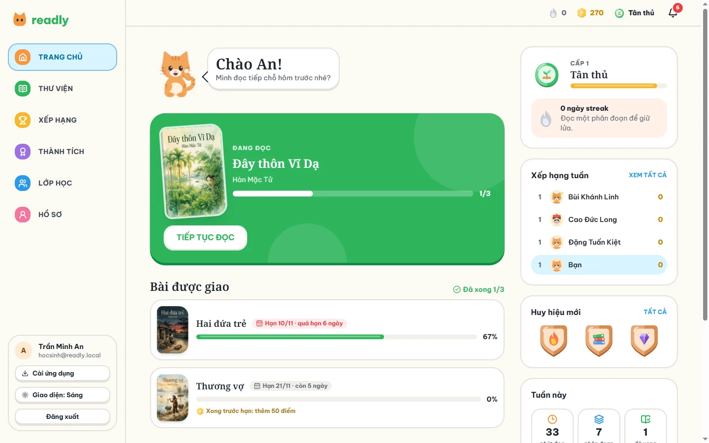</td>
    <td width="50%">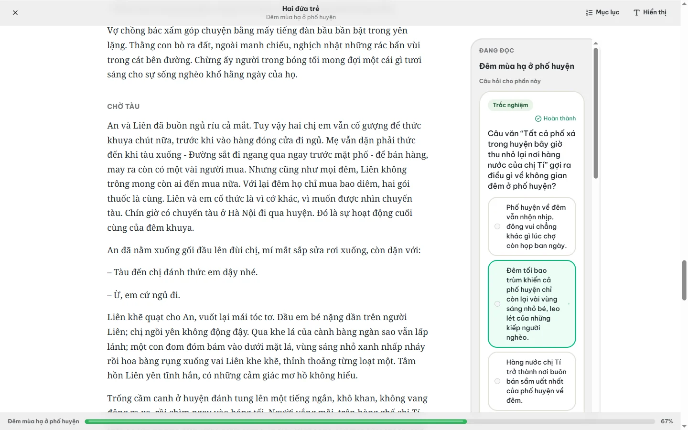</td>
  </tr>
  <tr>
    <td align="center"><sub>Student home: currently reading, assignments, weekly leaderboard, badges</sub></td>
    <td align="center"><sub>Reader: the text on the left, the segment's questions on the right</sub></td>
  </tr>
  <tr>
    <td>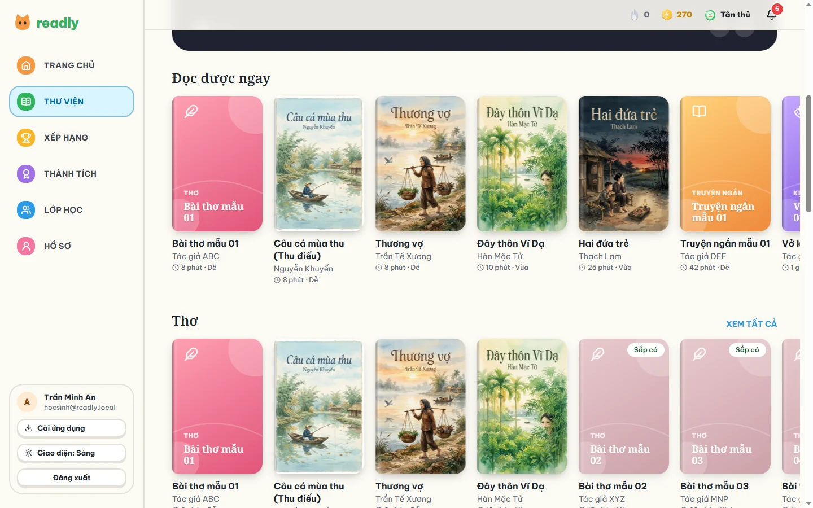</td>
    <td>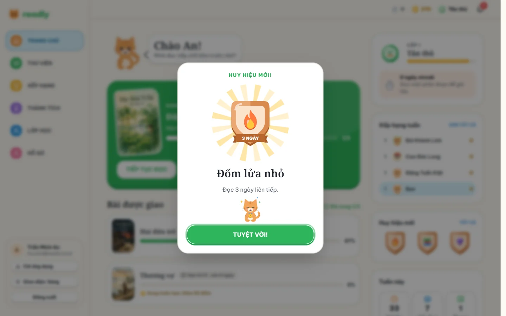</td>
  </tr>
  <tr>
    <td align="center"><sub>Library with 2:3 book covers</sub></td>
    <td align="center"><sub>New badge: Đốm lửa nhỏ (three-day streak)</sub></td>
  </tr>
  <tr>
    <td>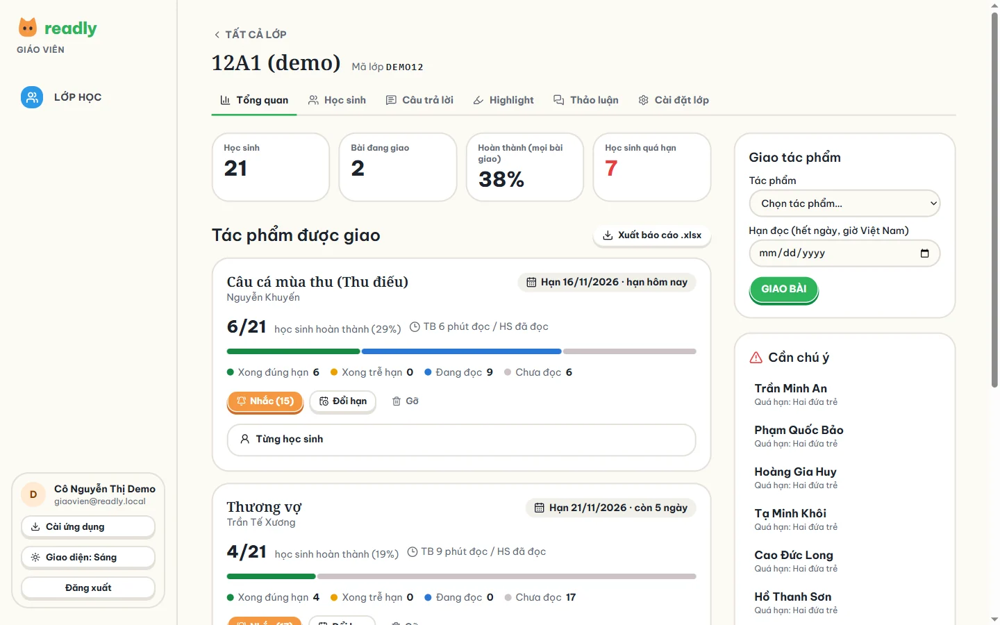</td>
    <td>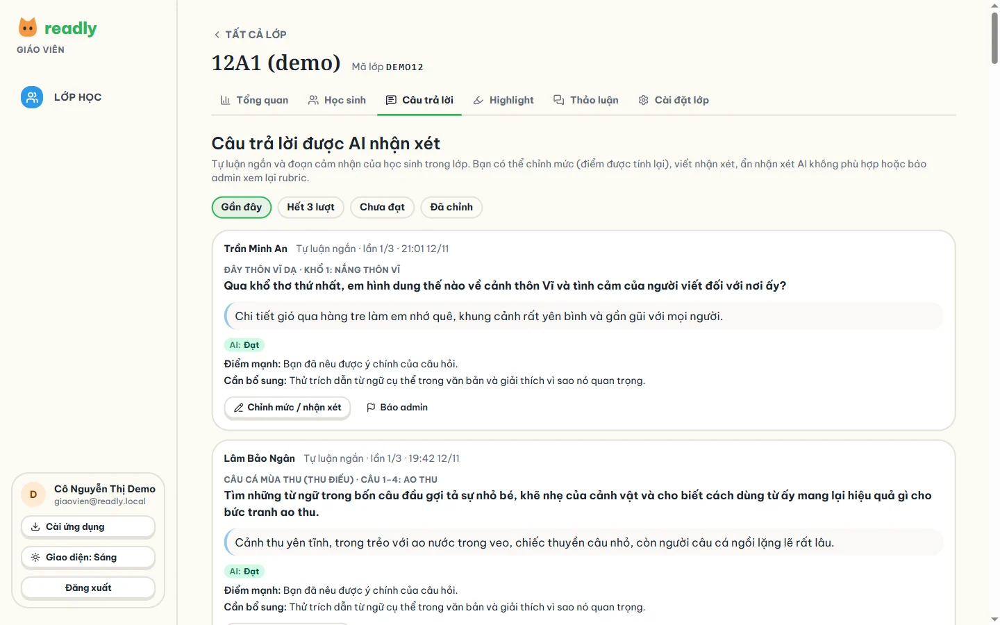</td>
  </tr>
  <tr>
    <td align="center"><sub>Teacher: assignment progress and students who need attention</sub></td>
    <td align="center"><sub>Teacher reviewing the AI's feedback</sub></td>
  </tr>
  <tr>
    <td>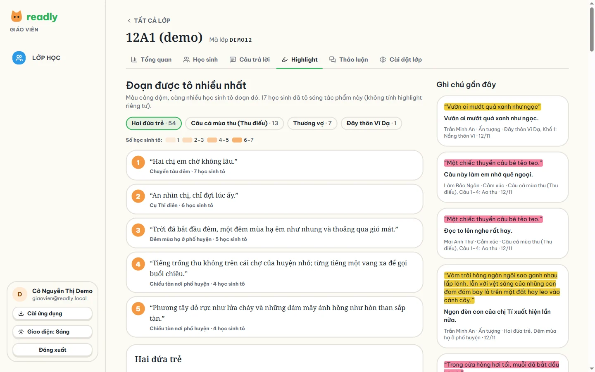</td>
    <td>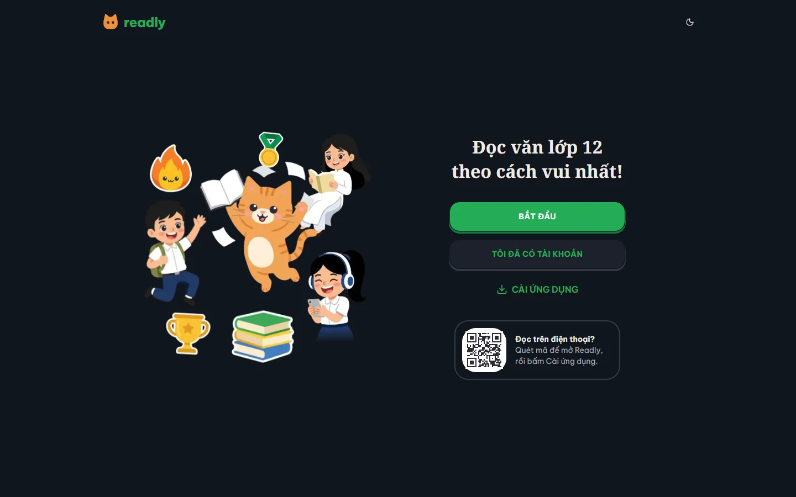</td>
  </tr>
  <tr>
    <td align="center"><sub>The passages the class highlighted most</sub></td>
    <td align="center"><sub>Dark mode</sub></td>
  </tr>
</table>

<p align="center">
  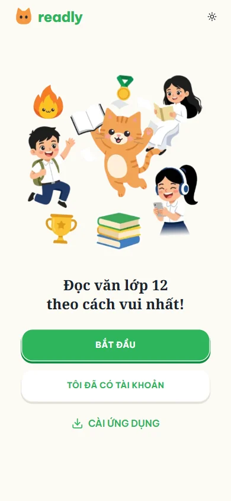<br>
  <sub>On a phone: one screen, with an Install app button</sub>
</p>

## How it works

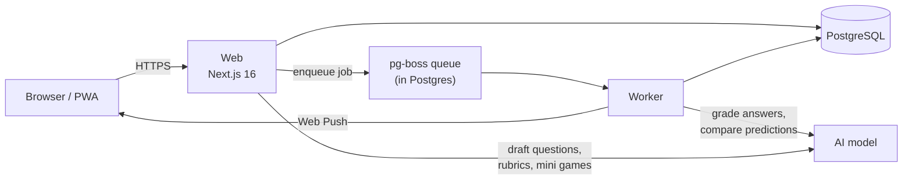

- **One codebase, two processes.** The web process serves pages and server actions; the worker grades answers with AI, sends notifications and deadline reminders. Both run from the same Docker image, selected by `SERVICE_ROLE`.
- **No Redis.** The pg-boss queue lives in PostgreSQL.
- **AI runs on the server only**, behind one interface for any OpenAI-compatible server (for example Token Harbor), Google Gemini, or an offline `mock` mode. Every response is validated against a schema before it is stored.
- **Authorization in the domain layer.** Teachers only see students currently in their classes; every server action checks the session and role first.

Details: [Architecture](docs/architecture.md).

## Run locally

You need Node.js 24 and Docker Desktop.

```bash
cp .env.example .env
docker compose up -d postgres
npm install
npm run db:migrate
npm run db:seed
npm run dev        # http://localhost:3000
npm run worker     # in another terminal
```

`AI_PROVIDER=mock` is the default, so every feature works without an API key. Tests, trying a real AI model and code conventions: [Development](docs/development.md).

## Documentation

| Page | What is there |
|---|---|
| [Architecture](docs/architecture.md) | Components, the AI grading flow, data, project layout |
| [Development](docs/development.md) | Running locally, checks, `ai:smoke`, content, conventions |
| [Deploy](docs/deploy.md) | Railway setup, deploy on merge, data after a deploy |
| [Configuration](docs/configuration.md) | Database, AI, seed and push notification settings |
| [Product brief](docs/CONTEXT.md) · [Spec](.plans/readly-reading-platform-spec.md) · [Implementation plan](.plans/readly-implementation-plan.md) | Original brief, detailed spec and per-phase log (in Vietnamese) |

## Tech stack

Next.js 16 (App Router, Cache Components) · React 19 · TypeScript · PostgreSQL + Prisma 7 · pg-boss · Tailwind CSS 4 + shadcn/ui · Vitest · Docker · Railway.

## Content and rights

- **Four works with full text**, all in the public domain; each source is listed in its `content/works/*.json` file: *Câu cá mùa thu* (Nguyễn Khuyến), *Thương vợ* (Trần Tế Xương), *Đây thôn Vĩ Dạ* (Hàn Mặc Tử), *Hai đứa trẻ* (Thạch Lam). Their questions were drafted by AI and reviewed by hand.
- **45 placeholder works** (`content/works.sample.json`) fill the library across genres; their text is sample text.
- The covers of the four works and the home page illustration were generated with AI for this project; Mướp the cat and the app icon are Readly's own artwork.

The source code belongs to the author's project; all rights reserved.
