<h1 align="center">
  <br>
  Readly
</h1>

<p align="center">
  <strong>Đọc văn lớp 12 theo cách vui nhất.</strong><br>
  Học sinh đọc từng phân đoạn, trả lời câu hỏi trước, trong và sau khi đọc, được AI nhận xét theo rubric, tích điểm, giữ chuỗi ngày đọc và nhận huy hiệu. Giáo viên giao bài và theo dõi cả lớp; admin soạn nội dung với trợ giúp của AI.
</p>

<p align="center">
  <a href="https://readly-production-3cec7280.up.railway.app"></a>
  <a href="https://github.com/xuan-tu-ai/Readly/actions/workflows/ci.yml"></a>
  
  
  
  
  
</p>

<p align="center">
  <a href="README.md">English</a> · <strong>Tiếng Việt</strong>
</p>

<p align="center">
  <a href="#dùng-thử">Dùng thử</a> · <a href="#điểm-nổi-bật">Điểm nổi bật</a> · <a href="docs/vi/architecture.md">Kiến trúc</a> · <a href="docs/vi/development.md">Phát triển</a> · <a href="docs/vi/deploy.md">Deploy</a> · <a href="docs/vi/configuration.md">Biến môi trường</a> · <a href="docs/CONTEXT.md">Mô tả sản phẩm</a>
</p>

<p align="center">
  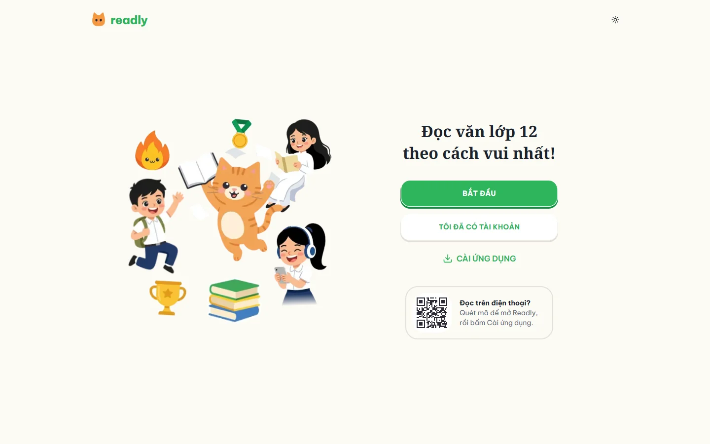
</p>

> [!NOTE]
> Readly là **đồ án kỹ thuật**. Không có học sinh hay giáo viên thật; mọi dữ liệu người dùng là dữ liệu mẫu.

## Dùng thử

Bản chạy online: **https://readly-production-3cec7280.up.railway.app**. Trên điện thoại, bấm **Cài ứng dụng** để thêm Readly vào màn hình chính như một app.

| Vai | Email | Mật khẩu |
|---|---|---|
| Học sinh | `hocsinh@readly.local` | `readly-hs-123` |
| Giáo viên (lớp 12A1, mã lớp `DEMO12`) | `giaovien@readly.local` | `readly-gv-123` |
| 20 học sinh mẫu trong lớp | `hs01@demo.readly.local` … `hs20@demo.readly.local` | `readly-hs-123` |

Có thể tự tạo tài khoản học sinh bằng nút **Bắt đầu** với mã lớp `DEMO12`. Tài khoản admin không công khai.

**Gợi ý xem nhanh**

1. **Học sinh** → trang chủ (đang đọc, bài được giao, chuỗi ngày đọc, xếp hạng tuần) → **Hồ sơ** (lịch sử đọc, highlight lọc theo màu và tác phẩm).
2. Mở *Hai đứa trẻ* → đọc tiếp, tô sáng một câu, trả lời câu tự luận → AI nhận xét sau vài giây.
3. **Giáo viên** → lớp 12A1 → tiến độ bài giao, duyệt nhận xét AI, bản đồ highlight của cả lớp, thảo luận, xuất báo cáo `.xlsx`, mã QR mời học sinh vào lớp.

## Điểm nổi bật

**Cho học sinh**

- **Đọc có hướng dẫn, ba giai đoạn.** Câu hỏi dự đoán trước khi đọc (AI so sánh dự đoán với diễn biến thật), câu hỏi giữa các phân đoạn, câu hỏi tổng hợp và đoạn cảm nhận sau khi đọc.
- **AI nhận xét theo rubric.** Mỗi câu tự luận được xếp mức *Chưa đạt / Đạt / Sâu sắc*, kèm điểm mạnh và gợi ý cụ thể, bám vào văn bản tác phẩm.
- **Trình đọc thoải mái.** Phân đoạn ngắn, tô sáng nhiều màu kèm ghi chú, cỡ chữ, phông chữ và nền đọc tùy chỉnh, nhớ chỗ đang đọc.
- **Động lực.** Điểm và cấp độ, chuỗi ngày đọc, huy hiệu có màn ăn mừng, bảng xếp hạng tuần trong lớp, mini game ghép cặp và đoán chi tiết.
- **Thảo luận** theo từng tác phẩm, có ghim, trả lời và báo cáo bài viết.

**Cho giáo viên**

- Giao bài có hạn chót, nhắc hạn tự động, thông báo đẩy.
- Bảng theo dõi lớp: ai đang đọc, ai trễ hạn, câu trả lời mới.
- Duyệt nhận xét của AI: đổi mức đạt, viết nhận xét riêng, ẩn nhận xét AI.
- Bản đồ highlight cho thấy cả lớp dừng lại ở câu nào; xuất báo cáo Excel.

**Cho admin**

- Nhập văn bản từ `.docx`, tự chia phân đoạn; highlight cũ tự gắn lại khi sửa văn bản.
- AI soạn nháp bộ câu hỏi, rubric và mini game; admin duyệt trước khi xuất bản.
- Tải ảnh bìa (tự cắt về 2:3), quản lý điểm thưởng, huy hiệu và báo cáo về nhận xét AI.

**Trên mọi thiết bị**

- Cài như ứng dụng (PWA): một chạm trên Android và máy tính, có hướng dẫn cho iPhone.
- Giao diện sáng và tối, dùng tốt trên điện thoại.

## Ảnh chụp màn hình

<table>
  <tr>
    <td width="50%">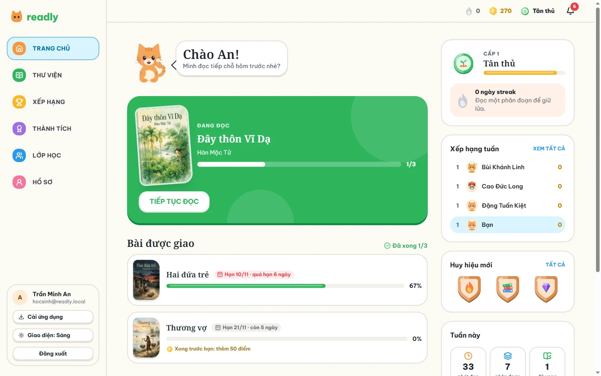</td>
    <td width="50%">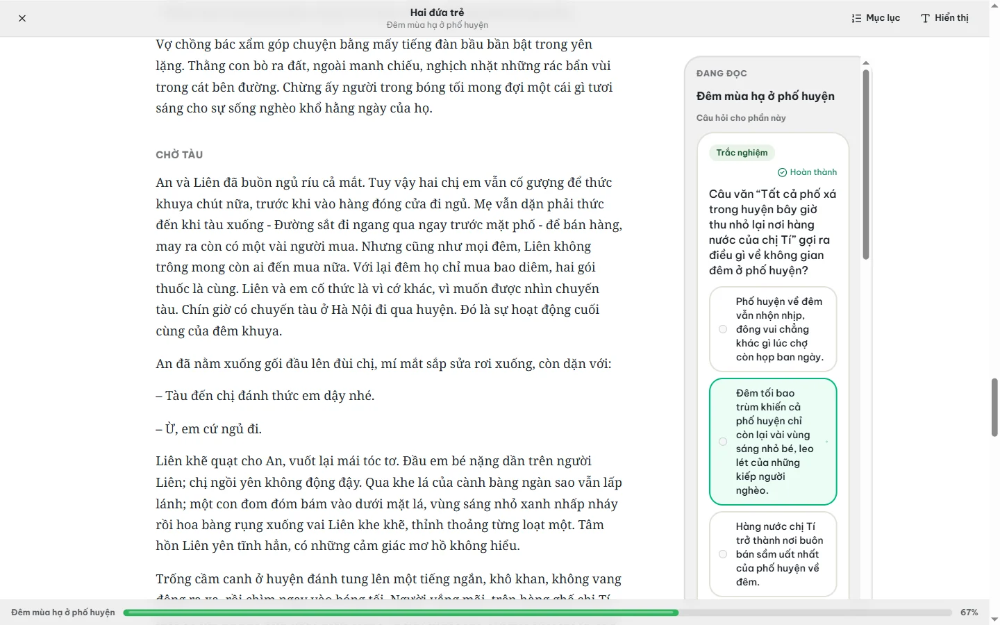</td>
  </tr>
  <tr>
    <td align="center"><sub>Trang chủ học sinh: đang đọc, bài được giao, xếp hạng tuần, huy hiệu</sub></td>
    <td align="center"><sub>Trình đọc: văn bản bên trái, câu hỏi của phân đoạn bên phải</sub></td>
  </tr>
  <tr>
    <td>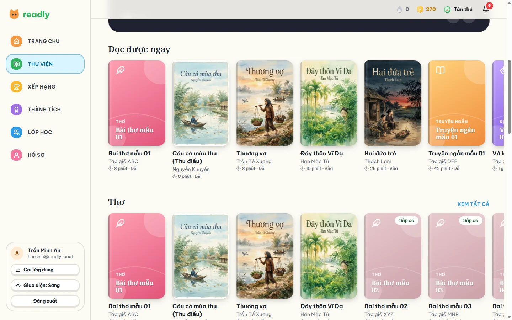</td>
    <td>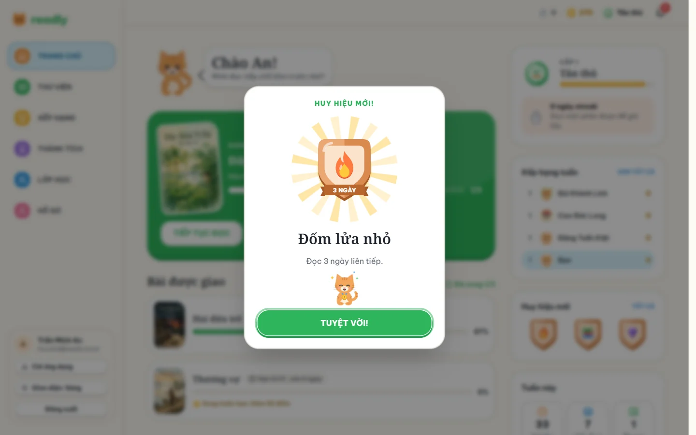</td>
  </tr>
  <tr>
    <td align="center"><sub>Thư viện, bìa tỉ lệ sách 2:3</sub></td>
    <td align="center"><sub>Huy hiệu mới: Đốm lửa nhỏ</sub></td>
  </tr>
  <tr>
    <td>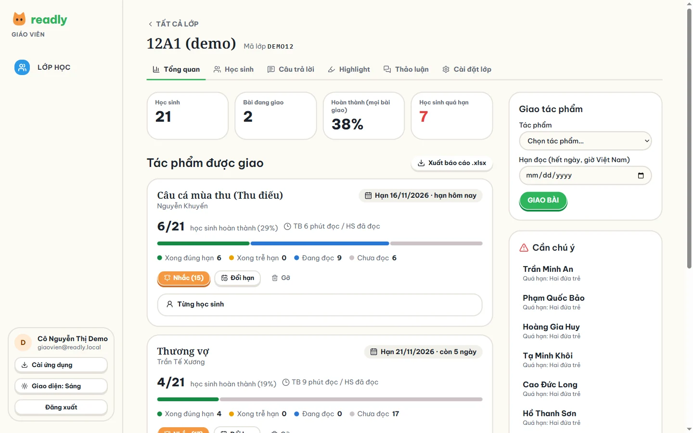</td>
    <td>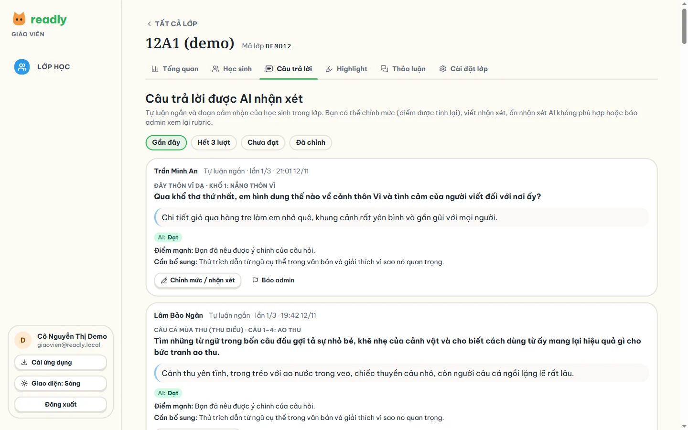</td>
  </tr>
  <tr>
    <td align="center"><sub>Giáo viên: tiến độ bài giao và học sinh cần chú ý</sub></td>
    <td align="center"><sub>Giáo viên duyệt nhận xét của AI</sub></td>
  </tr>
  <tr>
    <td>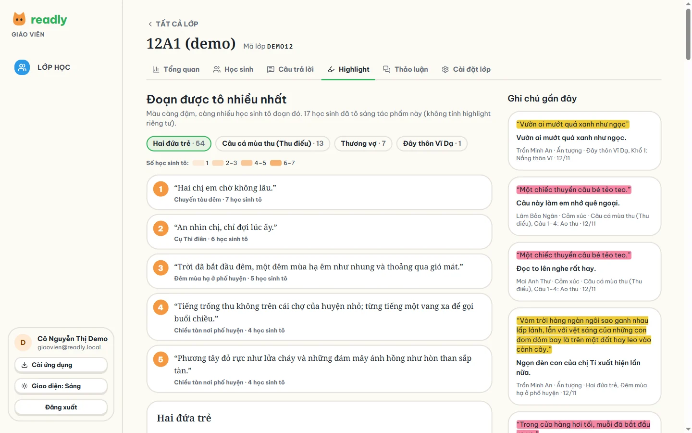</td>
    <td>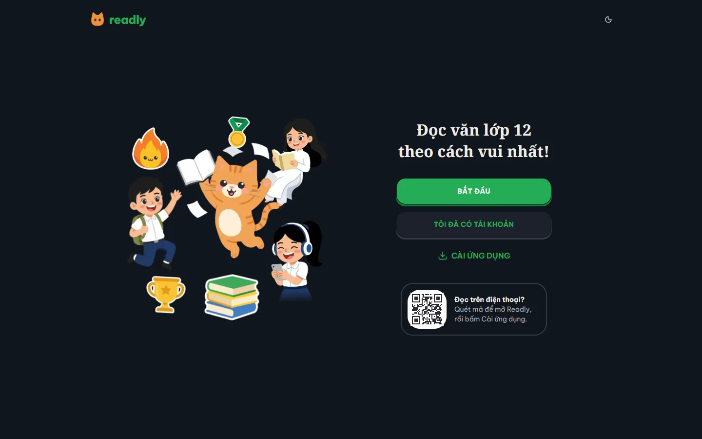</td>
  </tr>
  <tr>
    <td align="center"><sub>Đoạn được cả lớp tô sáng nhiều nhất</sub></td>
    <td align="center"><sub>Chế độ tối</sub></td>
  </tr>
</table>

<p align="center">
  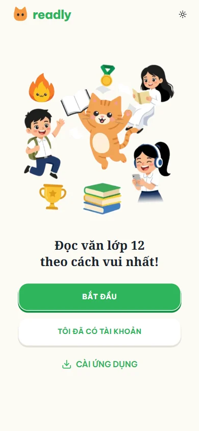<br>
  <sub>Trên điện thoại: vừa một màn hình, có nút Cài ứng dụng</sub>
</p>

## Cách hoạt động

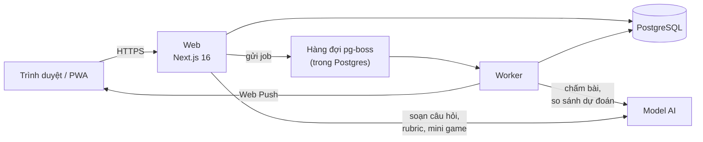

- **Một mã nguồn, hai tiến trình.** Web phục vụ trang và server action; worker chấm bài bằng AI, gửi thông báo và nhắc hạn. Cùng một Docker image, chọn vai bằng `SERVICE_ROLE`.
- **Không cần Redis.** Hàng đợi pg-boss nằm ngay trong PostgreSQL.
- **AI chỉ chạy ở server**, qua một giao diện chung cho máy chủ tương thích OpenAI (ví dụ Token Harbor), Google Gemini, hoặc chế độ `mock` không cần mạng. Mọi phản hồi được kiểm tra schema trước khi lưu.
- **Phân quyền ở tầng nghiệp vụ.** Giáo viên chỉ thấy học sinh đang ở lớp mình; mỗi server action kiểm tra phiên và vai trò trước khi làm gì.

Chi tiết: [Kiến trúc](docs/vi/architecture.md).

## Chạy local

Cần Node.js 24 và Docker Desktop.

```bash
cp .env.example .env
docker compose up -d postgres
npm install
npm run db:migrate
npm run db:seed
npm run dev        # http://localhost:3000
npm run worker     # cửa sổ khác
```

Mặc định `AI_PROVIDER=mock`, nên mọi tính năng chạy được mà không cần khóa API. Kiểm tra, thử AI với model thật và quy ước code: [Phát triển](docs/vi/development.md).

## Tài liệu

| Trang | Nội dung |
|---|---|
| [Mô tả sản phẩm](docs/CONTEXT.md) | Vai trò, tính năng, phạm vi của bản demo |
| [Kiến trúc](docs/vi/architecture.md) | Thành phần, luồng chấm bài bằng AI, dữ liệu, cấu trúc thư mục |
| [Phát triển](docs/vi/development.md) | Chạy local, kiểm tra, `ai:smoke`, nội dung, quy ước |
| [Deploy](docs/vi/deploy.md) | Dựng trên Railway, tự deploy khi merge, dữ liệu sau deploy |
| [Biến môi trường](docs/vi/configuration.md) | Database, AI, seed, thông báo đẩy |
| [Spec](.plans/readly-reading-platform-spec.md) · [Kế hoạch triển khai](.plans/readly-implementation-plan.md) | Đặc tả chi tiết và nhật ký từng phase |

## Công nghệ

Next.js 16 (App Router, Cache Components) · React 19 · TypeScript · PostgreSQL + Prisma 7 · pg-boss · Tailwind CSS 4 + shadcn/ui · Vitest · Docker · Railway.

## Nội dung và bản quyền

- **4 tác phẩm có toàn văn**, thuộc phạm vi công cộng; nguồn văn bản ghi trong từng file `content/works/*.json`: *Câu cá mùa thu* (Nguyễn Khuyến), *Thương vợ* (Trần Tế Xương), *Đây thôn Vĩ Dạ* (Hàn Mặc Tử), *Hai đứa trẻ* (Thạch Lam). Câu hỏi do AI soạn nháp rồi được rà lại bằng tay.
- **45 tác phẩm giữ chỗ** (`content/works.sample.json`) để thư viện đủ thể loại; văn bản là văn bản mẫu.
- Ảnh bìa của 4 tác phẩm và minh họa trang chủ được vẽ bằng AI cho dự án này; mèo Mướp và biểu tượng là đồ họa của Readly.

Mã nguồn thuộc đồ án của tác giả, giữ mọi quyền.
