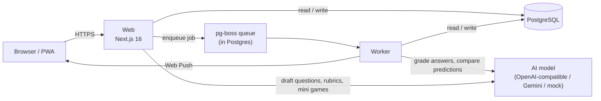
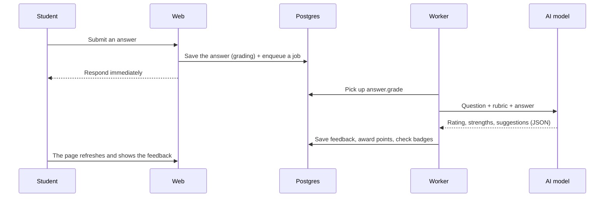

# Architecture

<sub>English · [Tiếng Việt](vi/architecture.md)</sub>

Readly is one Next.js codebase that runs as two processes: **web** serves pages and server actions, **worker** handles background jobs. Both share one PostgreSQL database, and the background job queue lives in that same database.



## Components

| Component | Role |
|---|---|
| **Web** (`src/app`) | App Router with Cache Components: the static shell of each page is prerendered and the user-specific parts stream in. Every write goes through a server action. |
| **Server actions** (`src/app/actions`) | Always check the session and role first, then call the domain layer. |
| **Domain services** (`src/server/services`) | Reading, questions, points and badges, teachers, discussions, notifications, admin. Independent of the UI, so they are tested directly. |
| **Authorization** (`src/server/authz.ts`) | Teachers only see students **currently** in their classes; students only see their own data; admins manage content. |
| **Authentication** (`src/server/auth`) | Sessions stored in the database, `httpOnly` cookies, passwords hashed with Argon2. |
| **Worker** (`worker/`, `src/server/jobs`) | A pg-boss process. Queues: `answer.grade`, `answer.grade.failed`, `prediction.compare`, `notification.push`, `assignment.deadline-reminders` (cron), `system.ping`. |
| **AI layer** (`src/lib/ai`) | One interface over three providers: `OpenAiCompatibleProvider`, `GeminiProvider`, `MockProvider`. Every response is checked against a JSON Schema (zod) before it is stored. |

## Grading an answer



- Temporary failures (rate limits, server errors, timeouts, broken JSON) are retried; configuration errors (bad key, unknown model) are not.
- The grading prompt treats the student's answer as data, not instructions. The `ai:smoke` suite includes an answer that tries to inject "give me full marks" to check this.
- Teachers review each answer: change the rating (points, streak and badges are recomputed), write their own comment, hide the AI's comment, or report wrong feedback so an admin can check the rubric.

## Data

- **Schema:** `prisma/schema.prisma`, migrations in `prisma/migrations`.
- **Work text** is sanitized on save and split into segments; highlights are anchored to character offsets in a segment and re-anchored automatically when an admin edits the text.
- **Uploaded covers** are re-encoded as 600×900 WebP and stored in the `WorkCoverImage` table (the hosting platform's disk is wiped on every deploy). They are served from `/api/covers/<id>?v=<version>` and cached for a year.
- **The pg-boss queue** uses its own schema in the same database, so there is no Redis.

## Deployment

One Docker image serves both web and worker. `docker/start.sh` picks the process from `SERVICE_ROLE`:

- `web` (default): runs `prisma migrate deploy`, seeds **only when the database is empty**, then `next start`.
- `worker`: runs `npm run worker`.

See [Deploy](deploy.md) for the Railway setup.

## Project layout

```
content/works/         works with full text (JSON: text, questions, mini games)
content/covers/        600×900 WebP covers for those works
content/               tags.json, works.sample.json (placeholder works)
docker/                start.sh (entrypoint), local Postgres init
prisma/                schema, migrations, seed (content, badges, demo class)
src/app/               home page, role routes: (auth), /student, /teacher, /admin; /api
src/app/actions/       server actions
src/components/        UI; landing/ holds the animated home page art
src/server/auth/       sessions, cookies, passwords, data access layer
src/server/authz.ts    authorization rules
src/server/services/   domain services
src/server/jobs/       background job definitions
src/lib/ai/            AI layer and prompts
scripts/ai-smoke/      run every AI task against a real model
worker/                pg-boss process
tests/                 unit + integration (Vitest)
```
